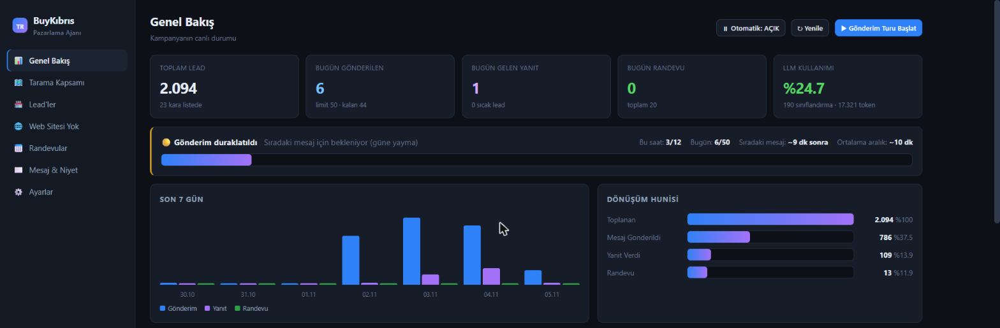

# 📈 BuyKibris Marketing Agent

> An autonomous **AI sales & outreach agent** — it finds businesses, reaches out, follows up and books appointments, on its own.

A background AI system that runs an entire outbound sales pipeline. It discovers businesses from maps, figures out which ones have no website, writes and sends each a personalized message, follows up, and books appointments — while a live dashboard tracks the whole funnel.

> ℹ️ This is a **showcase repository** — documentation and screenshots only. The source code is private; the dashboard above is shown with sample figures and no customer data.

---

## ✨ What it does

### 🔎 Lead discovery
- Scans **Google Maps** for businesses in a target area and category.
- Flags the ones **without a website** (the best outreach targets) and keeps a blacklist of who not to contact.

### 🤖 AI outreach & negotiation
- An LLM classifies each lead's intent and drafts a **personalized** message.
- Sends messages on a **rate‑limited, human‑paced** schedule, follows up, and handles the back‑and‑forth toward booking an appointment.

### 📊 Live funnel dashboard
- Real‑time overview: **total leads, sent today, replies, appointments, LLM usage.**
- A **conversion funnel** — collected → messaged → replied → appointment — plus a 7‑day activity chart.
- Integration health for the database, background workers and maps.

### ⚙️ Built to run continuously
- **Celery + Redis** background workers push the pipeline forward around the clock.
- Automatic sending can be paused/resumed; daily and hourly send limits keep it safe.

---

## 🛠️ Tech stack
**Python** · **SQLite** · **Celery** + **Redis** workers · **Google Maps** API · **LLM** for classification & message generation.

---

## 👤 Author
Built by **Mehmet Faruk Aydın** — [@mefaay](https://github.com/mefaay) · Software Developer & Tech Lead, Nicosia (N. Cyprus).
